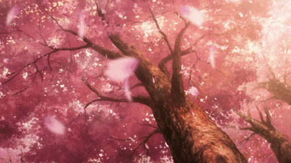
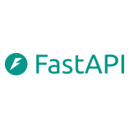
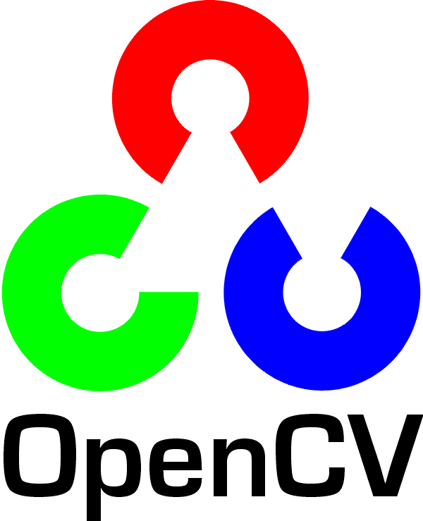
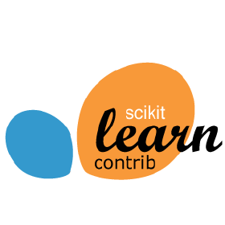

<!-- ===================== -->
<!-- MAIN HEADER -->
<!-- ===================== -->

  

<!-- CUTE GIF UNDER HEADER -->

  

---

<!-- ABOUT ME -->

  

 I'm a Computer Science student at Kennesaw State University with interests in artificial intelligence, software development, and computer networking. I currently work as an IT Student Assistant at the Georgia Tech Research Institute, where I gain hands-on experience troubleshooting hardware and software systems. Through my coursework, research, and personal projects, I'm continuing to develop my programming skills and explore how technology can be applied to solve real-world problems.

---

<!-- PROJECTS -->

  

  • JabSense
    -Machine learning-based boxing jab classification using computer vision and pose estimation.
    -Technologies: Python, OpenCV, MediaPipe, scikit-learn
    -Repository coming December 2026.
  
  • OwlFind
    -A university lost-and-found web application featuring item reporting and matching functionality.
    -Technologies: Python, FastAPI, HTML, CSS
    -Repository coming December 2026.
    
  • TCP/UDP Web Streaming
    -Multi-client webcam streaming over TCP and UDP for comparing network performance.
    -Technologies: Python, OpenCV, Socket Programming
    -Repository coming December 2026.
  

---

<!-- COURSEWORK -->

  

  📂 <a href="./CSE1321/">CSE 1321- Introduction to Python(Fall 2024-Spring 2024)</a>

  📁 <a href="./CSE1322/">CSE1322- Introduction to Java (Summer 2025) </a>

  📁 <a href="./CS3305/">CS3305- Data Structures (Fall 2025) </a>

  📁 <a href="./CS3503/">CS3503- Computer Organization and Architecture (Spring 2026) </a>

  📁 <a href="./CS3410/">CS3410- Intro to Database Systems (Spring 2026) </a>

---

<!-- SKILLS -->

  

  
  &nbsp;&nbsp;

  
  &nbsp;&nbsp;

  
  &nbsp;&nbsp;

  
  &nbsp;&nbsp;
  
  &nbsp;&nbsp;
  
  &nbsp;&nbsp;
  
  &nbsp;&nbsp;

---

<!-- CONTACT -->

  

  Email: brookealfred2005@gmail.com  
   
  LinkedIn: https://linkedin.com/in/brookejordanalfred

